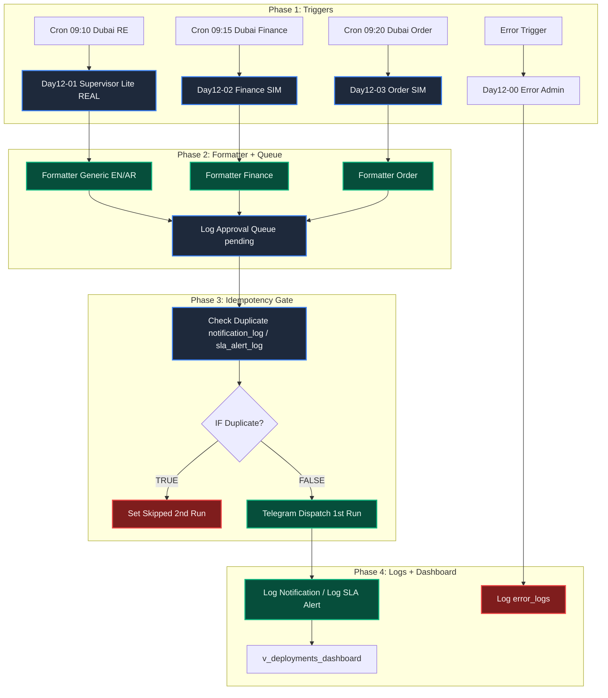

# 📊🏙️ Day12-Supervisor-Lite-DXB – Enterprise Dubai Deal Desk – FREE Stack


Prod-grade Dubai Deal Desk Day 12 — Supervisor Lite + Human Approval + Idempotency — Telegram Replaces $35/mo Whapi — n8n 2.43.5 + Supabase + Telegram

> Day 12/30 of 30-Day AI Sprint | FREE Stack (No Whapi) | RE 28 production + Finance 2 SIM + Order 2 SIM | 1st Run = Telegram ✅ | 2nd Run Same Hour = Set Skipped, Telegram 0 | approval_queue 11 pending | All Green Nodes

---

## ✨ Features – Day 12 Upgrade (vs Day 11)

- 📲 **Supervisor Lite – NEW Day 12** – `Day12-01` RE Leads REAL → 3 RPCs → Merge → 1 Telegram digest. Bilingual EN / AR. `alert_type`: `sla_breach_1min`, `handoff_pending`, `hot_lead`, `followup_overdue`, `generic_action`
- 💰 **Finance Approval – NEW Day 12** – `Day12-02` SIMULATED → `finance_expenses_sim` EXP-1201 AED 12000 overdue Conf 0.82 → Formatter Finance → `💰 Finance Desk - Approval Needed` + ✅ Approve | ❌ Reject
- 📦 **Order Processing – NEW Day 12** – `Day12-03` SIMULATED → `ecom_orders_sim` ORD-8821 payment_failed AED 450 + ORD-8822 stock_short AED 1200 → Formatter Order → `📦 Order Processing - 2 exceptions | At Risk AED 1650` + ✅ Resolve | ❌ Escalate
- 🛡️ **Idempotency Gate – NEW Day 12** – `Check Duplicate` BEFORE Telegram in `notification_log` / `sla_alert_log`. `UNIQUE(alert_type + channel + hour)` → 1st Run = Telegram, 2nd Run = `Set Skipped`
- 👤 **Human-in-the-Loop – NEW Day 12** – Every alert logs `approval_queue` FIRST (pending, `requires_approval=TRUE`) → Then Telegram asks. No auto-approve for money / stock.
- ⚠️ **Error Trigger Admin – NEW Day 12** – `Day12-00` Error Trigger → Set Error Context → Is Critical? → Telegram Admin → Log `error_logs`. Production only. Short error, no JSON dump, no secrets.
- 🔁 **Reliability** – `Always Output Data ON` + `All Filters AND` + `Limit 1` + `Response: Immediately` – prevents workflow stop on empty duplicate check.

---

## 🏗 Architecture – Day 12

[Architecture Day 12 – Light Version](screenshots/01-Architecture-Day12-Light.png)
[Architecture Day 12 – Dark Version](screenshots/02-Architecture-Day12-Dark.png)



## 💾 Supabase Persistence Layer – Day 12

**Table `v_deployments_dashboard`:**
- `business_type`, `active_leads`, `overdue_leads`, `deployment_type` production | SIMULATED
- 3 rows: RE Leads 28 production + Expense Recon 2 SIM + Order Returns 2 SIM

**Table `finance_expenses_sim`:**
- `id`, `expense_id` EXP-1201 / EXP-1202, `amount` 12000 / 8500, `vendor`, `status` overdue | pending, `confidence` 0.82 / 0.75

**Table `ecom_orders_sim`:**
- `id`, `order_id` ORD-8821 / ORD-8822, `status` exception, `exception_type` payment_failed / stock_short, `amount` 450 / 1200

**Table `notification_log` – Day 12 NEW:**
- `id`, `lead_id`, `alert_type`, `channel` telegram, `business_type`, `sent_at`, `telegram_message_id`
- 2 rows: `order_exception` + `sla_breach_1min` — 1st Run only

**Table `approval_queue` – Day 12 NEW:**
- `id`, `lead_id`, `alert_type`, `business_type`, `status` pending → approved / rejected, `requires_approval` TRUE, `requested_at`, `decided_at`, `decided_by`
- 11 pending: Finance + Order

**Table `sla_alert_log`:**
- `id`, `lead_id`, `alert_type`, `sent_at`, `unique(lead_id, alert_type, date_trunc('hour', sent_at))`

**Functions:**
- `get_daily_ops_metrics()` – jsonb Dubai today at time zone Asia/Dubai
- `get_top_action_leads()` – case SLA BREACH / HUMAN HANDOFF / DUE SOON / NEW QUALIFIED, limit 5
- `get_sla_breached_leads()` – follow_up_due_at < now()-1min AND not exists in sla_alert_log within 60min

---

## ⏰ Idempotency Fix – Day 12 NEW

### Cron:
```
Schedule Trigger 09:10 / 09:15 / 09:20 Dubai
  -> Supabase Get (RPC / Get Many)
  -> Formatter Generic (EN/AR, HTML)
  -> Log Approval Queue (pending, requires_approval=TRUE)
  -> Check Duplicate (All Filters AND, Limit 1, Always Output Data ON)
  -> IF Duplicate? FALSE = Telegram | TRUE = Set Skipped
  -> Log Notification / Log SLA Alert
```

### SQL:
```sql
create unique index if not exists ux_notification_log_idem
on notification_log (lead_id, alert_type, channel, date_trunc('hour', sent_at));

-- Check Duplicate: All Filters AND
-- alert_type = sla_breach_1min AND channel = telegram AND sent_at > now() - interval '1 hour'
-- Empty {} = NOT duplicate -> Telegram. 1 row = duplicate -> Set Skipped.
```

> Business Value: 50 Telegrams / hour → 1 max / hour – 2nd Run Same Hour = Skipped – 0 Spam.

---

## 📊 Results – Day 12

### 🚀 Production Executions – All Green Nodes

| Workflow | Execution | Result | Proof |
| --- | --- | --- | --- |
| **Day12-01 RE Supervisor Lite** | `1st Run` | ✅ `Telegram Dispatch` `1 item executed` | `notification_log sla_breach_1min` |
| **Day12-01 RE Supervisor Lite** | `2nd Run Same Hour` | ✅ `Set Skipped` `skipped_duplicate` | `0 Spam` |
| **Day12-02 Finance Approval** | `1st Run` | ✅ `Telegram Dispatch` `1 item executed` | `EXP-1201 AED 12000` |
| **Day12-02 Finance Approval** | `2nd Run Same Hour` | ✅ `Set Skipped` | `0 Spam` |
| **Day12-03 Order Processing** | `1st Run` | ✅ `Telegram Dispatch` `1 item executed` | `ORD-8821 + ORD-8822` |
| **Day12-03 Order Processing** | `2nd Run Same Hour` | ✅ `Set Skipped` | `0 Spam` |
| **Day12-00 Error Admin** | `Exec 13291 Succeeded 1.25s` | ✅ `Telegram Admin Alert` | `error_logs 1 clean row` |

#### 📲 Day12-01 RE – Telegram Dispatch Green Tick
> `Cron 09:10 Dubai` → `3 RPCs` → `Merge` → `Formatter Generic` → `Log Approval Queue` → `Check Duplicate 0 rows` → `Telegram Dispatch`

#### 💰 Day12-02 Finance – Telegram Dispatch Green Tick
> `Cron 09:15 Dubai` → `Get Overdue Expenses (1)` → `Formatter Finance` → `Log Approval Queue` → `Check Duplicate 0 rows` → `Telegram Dispatch`

#### 📦 Day12-03 Order – Telegram Dispatch Green Tick
> `Cron 09:20 Dubai` → `Get Order Items (2)` → `Formatter Order` → `Log Approval Queue` → `Check Duplicate 0 rows` → `Telegram Dispatch`

#### ⚠️ Day12-00 Error – Admin Alert
> `Error Trigger` → `Set Error Context` → `Is Critical?` → `Telegram Admin Alert` → `Log error_logs`

### 📬 Telegram Proof – Real
```
Subject: 📊 Dubai Deal Desk - RE Leads Audit
Top 5 Leads | SLA OK | Score 95 Hot
---
Subject: 💰 Finance Desk - Approval Needed
EXP-1201 | AED 12000 | Vendor Generic Supplier | Conf 82%
---
Subject: 📦 Order Processing - 2 exceptions | At Risk AED 1650
ORD-8821 payment_failed | ORD-8822 stock_short
```

---

## 🛠 Tech Stack – Day 12

| Technology | Version | Purpose |
| --- | --- | --- |
| **n8n** | 2.43.5 Self-Hosted Docker | Workflow orchestration – Supervisor Lite + Finance + Order + Error Admin |
| **Supabase** | Postgres | notification_log, sla_alert_log, approval_queue, v_deployments_dashboard, finance_expenses_sim, ecom_orders_sim |
| **Telegram** | Bot API | Supervisor Lite + Finance + Order + Admin alerts – FREE, replaces $35/mo Whapi |
| **Docker** | 4.95.0 | filesystem binaryDataMode |

---

## 📸 Screenshots – Day 12

### 1. Architecture Day 12 – FREE Stack Supervisor Lite + Human Approval (Main)
[Architecture Light](screenshots/01-Architecture-Day12-Light.png)

### 2. Workflow Day 12 – Full Workflow 1st Run Telegram + 2nd Run Skipped
[Workflow Light](screenshots/03-Workflow-Day12-Light.png)

### 3. Telegram Dispatch – 1st Run Green Tick – RE + Finance + Order + Error
[Telegram Dispatch](screenshots/04-Telegram-Dispatch-Day12.png)

### 4. Set Skipped – 2nd Run Same Hour – Idempotency Proof
[Set Skipped](screenshots/05-Set-Skipped-Day12.png)

### 5. Supabase Proof – Only Necessary Tables – Recruiter Notes
[Supabase](screenshots/06-Supabase-Day12-Recruiter-Notes.png)

### 6. GitHub README – For LinkedIn Post
[README Screenshot](screenshots/07-GitHub-README-Day12.png)

---

## 🐛 Production Bugs Fixed – Day 11 vs Day 12

| # | Day 11 ❌ Problem | Day 12 ✅ Fix | Impact |
| --- | --- | --- | --- |
| 1 | **50 Telegrams/hour** – No gate before Telegram | `Check Duplicate` BEFORE Telegram + `UNIQUE hour` | **1 max/hour** – Proof `0 spam` |
| 2 | **2nd Run re-sent** – Duplicate check after Telegram | `Check Duplicate` → `IF Duplicate?` → `Telegram OR Set Skipped` | **2nd Run = Skipped** |
| 3 | **Double-wiring** – Formatter → Telegram AND Queue | Single chain: `Formatter → Log Queue → Check Duplicate → Telegram` | **No double-send** |
| 4 | **Empty duplicate = workflow stop** – Check Duplicate 0 rows stopped | `Always Output Data ON` + `Object.keys(...).length != 0` check | **Workflow continues** |
| 5 | **Supabase Filter** – Text `Is` = only null/true/false | Text = `Equal` (`eq.`) | **Filter works** |
| 6 | **Telegram Markdown** – `_` in `sla_breach_1min` breaks parse | HTML only `<b>`, `<code>`, `<a href>` | **Parse OK** |

> **Key Patterns:** `Always Output Data ON` + `All Filters AND` + `Limit 1` + `UNIQUE hour` + `Response Immediately` prevents spam + workflow stop.

## 🔮 What's Next – Day 13 + Multi-Agent System

### Day 13 – WhatsApp Cloud API + Real Human Approval
- WhatsApp Cloud API — 1000 FREE conversations / month
- Real Inline Keyboard: ✅ Approve / ❌ Reject with `callback_data` (1-64 bytes)
- Approval: `pending → approved / rejected → logged` in `approval_queue` + `notification_log`
- Routing: RE / Finance / Order → correct agent + correct formatter

### Day 14+ – Multi-Agent System
```
User / Cron / WhatsApp / Telegram
  → Router Agent (intent + business_type + language EN/AR)
    → RE Leads Agent (SLA, handoff, hot lead)
    → Finance Agent (expense, confidence, approval)
    → Order Agent (exception, stock, payment)
  → Supervisor Lite (aggregates, deduplicates, idempotency gate)
  → Human Approval (only when requires_approval=TRUE)
  → Evaluation / Regression (40 cases, Day 12 matrix)
```

---

## 👨💻 Author
**Toqeer Ahmad** – Dubai, UAE 🇦🇪
AI Automation • Enterprise RAG • WhatsApp Bots • Lead Automation • n8n • Gemini 3.5 Flash Lite • Supabase pgvector • Qdrant • Arabic + Dubai dialect

---

## 📄 License
Proprietary — All Rights Reserved. See LICENSE file. Viewing allowed for recruitment only.

---

## 🔗 Related
- **Day 11:** https://github.com/Toqeer-Ahmad-ops/Enterprise-Dubai-RE-Architecture-FREE-Ops-Digest
- **Day 9+10:** https://github.com/Toqeer-Ahmad-ops/RE-LEAD-Engine-DXB
- **Day 8:** https://github.com/Toqeer-Ahmad-ops/dubai-real-estate-lead-automation
